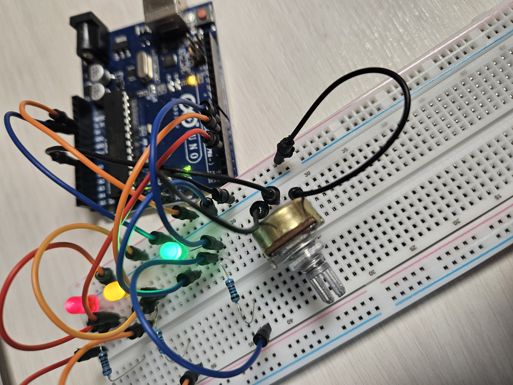
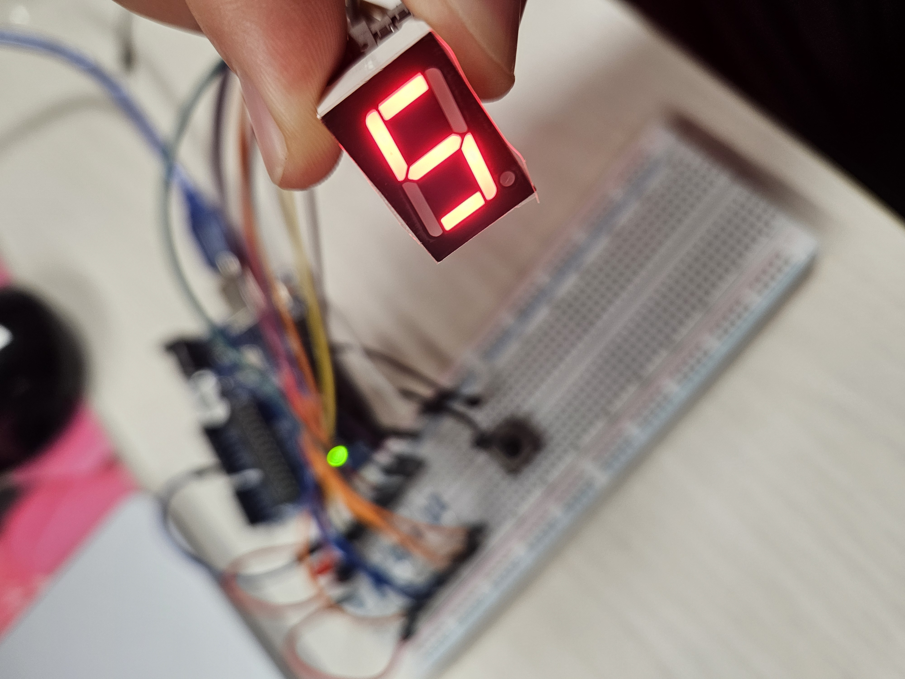
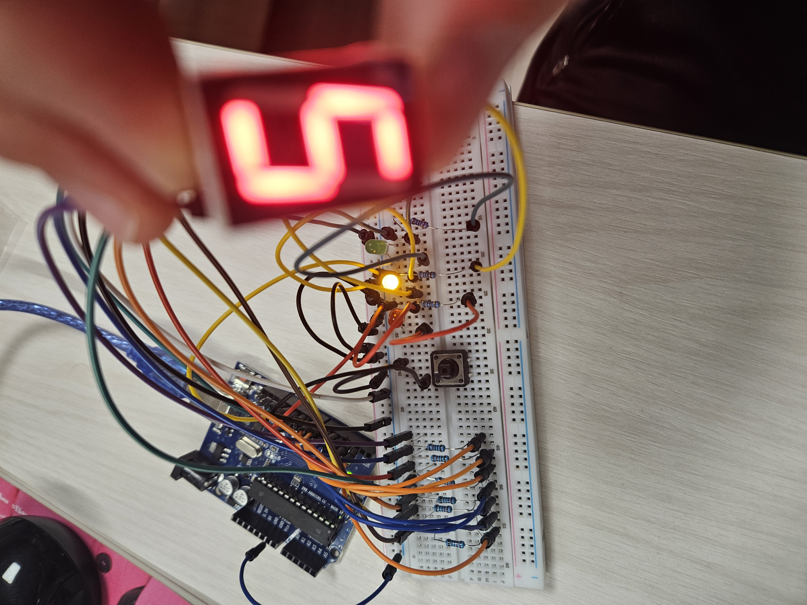

# Arduino Uno 회로 실습

Arduino Uno와 브레드보드로 LED, 버튼, 가변저항, 사운드 센서, 7세그먼트를 하나씩 붙여 보며 진행한 실습 기록입니다.
코드보다는 **어떻게 연결했는지, 왜 그렇게 연결해야 하는지, 실습 중 겪은 문제와 해결 방법**을 중심으로 정리했습니다.

## 준비물

| 부품 | 수량 | 비고 |
|---|---|---|
| Arduino Uno | 1 | USB 연결 (COM5) |
| 브레드보드, 점퍼선 | 1 세트 | |
| LED (빨강, 노랑/주황, 초록) | 각 1 | |
| 저항 220~330Ω | 10개 이상 | LED, 7세그먼트 전류 제한용 |
| 택트 스위치 (4핀 버튼) | 1 | |
| 가변저항 (10kΩ) | 1 | |
| 사운드 센서 모듈 (AO/DO 출력) | 1 | |
| 7세그먼트 (1자리, 공통 캐소드) | 1 | |

## 업로드 환경

Arduino IDE 대신 `arduino-cli`로 컴파일과 업로드를 했습니다.

```sh
arduino-cli board list                        # 연결된 보드와 포트 확인
arduino-cli core install arduino:avr          # Uno 지원 패키지 설치 (최초 1회)
arduino-cli compile --fqbn arduino:avr:uno --upload -p COM5 ./스케치폴더
arduino-cli monitor -p COM5 -c baudrate=9600  # 시리얼 모니터
```

> arduino-cli는 **폴더 이름과 `.ino` 파일 이름이 같아야** 컴파일됩니다. (예: `TrafficLight/TrafficLight.ino`)

---

## 1. 내장 LED 블링크와 잔상 효과

- **회로:** 추가 부품 없음. Uno 보드의 13번 핀에 연결된 내장 LED(`LED_BUILTIN`)를 사용합니다.
- **실습:** `delay()` 값을 바꿔 가며 켜짐/꺼짐 간격을 바꿔 봤습니다.

| 간격 | 1초당 깜빡임 | 눈으로 본 결과 |
|---|---|---|
| 0.1초 | 5번 | 또렷하게 깜빡임 |
| 0.05초 | 10번 | 빠르지만 깜빡임이 보임 |
| 0.01초 | 50번 | 거의 켜져 있는 것처럼 보임 |
| 0.005초 | 100번 | 깜빡임이 보이지 않음, 약간 어두움 |
| 0.001초 | 500번 | 깜빡임이 보이지 않음, 약간 어두움 |

**알게 된 점:** 대략 1초에 50번 이상 깜빡이면 사람 눈에는 계속 켜진 것처럼 보이고, 켜져 있는 시간 비율만큼 어둡게 느껴집니다. 이 원리가 뒤에 나오는 **PWM 밝기 조절**의 기초입니다.

---

## 2. LED 3개 신호등

```
A5 ──[330Ω]──▶|── GND   빨강
A4 ──[330Ω]──▶|── GND   노랑
A3 ──[330Ω]──▶|── GND   초록
          (긴 다리 +)(짧은 다리 −)
```

- LED는 극성이 있습니다. **긴 다리(+, 애노드)**는 핀 쪽, **짧은 다리(−, 캐소드)**는 GND 쪽에 연결합니다.
- 저항이 없으면 LED와 핀에 전류가 너무 많이 흐르므로 반드시 저항을 직렬로 넣습니다.
- A0~A5는 아날로그 입력 핀이지만 `digitalWrite`로 일반 디지털 출력처럼 쓸 수 있습니다.

**예제:** `TrafficLight` (초록 → 노랑 → 빨강을 1초씩 차례로 켭니다)

---

## 3. 버튼 입력 (내부 풀업)

```
A0 ──┐
     ┤ 버튼 (대각선 방향 다리 사용)
GND ─┘
```

- `pinMode(A0, INPUT_PULLUP)`으로 보드 내부 저항을 켜면 외부 저항 없이 버튼을 연결할 수 있습니다.
- 내부 풀업에서는 값이 **반대로** 읽힙니다.
  - 안 누름: `HIGH`(1). 내부 저항이 5V 쪽으로 끌어올립니다.
  - 누름: `LOW`(0). 버튼이 핀을 GND에 직접 연결합니다.

### 실습 중 겪은 문제: 버튼을 눌러도 반응 없음

시리얼로 A0 값을 찍어 보니 버튼을 눌러도 계속 `1`(아날로그 1023)이었습니다. 원인을 하나씩 좁혀 갔습니다.

1. **버튼 반대쪽을 5V에 연결함:** 내부 풀업에서는 이미 HIGH라서 5V에 연결해도 변화가 없습니다. 반대쪽은 **GND**에 연결해야 합니다.
2. **버튼 다리 선택:** 4핀 택트 스위치는 같은 쪽 다리 두 개가 내부에서 이미 연결돼 있습니다. **대각선 방향 다리**를 쓰고, 브레드보드 가운데 홈을 가로질러 꽂아야 합니다.
3. **버튼을 빼고 시험:** A0 선을 GND에 직접 대서 LED가 켜지는지 확인했습니다. 켜지면 코드와 핀은 정상이고, 문제는 버튼을 꽂은 방식입니다.

### 예제
- `ButtonLed`: 누르고 있는 동안만 LED 3개가 켜집니다.
- `ButtonToggle`: 누를 때마다 켜짐과 꺼짐이 바뀝니다.
  - **누르는 순간**만 감지해서 오래 눌러도 한 번만 바뀝니다.
  - **채터링 방지:** 버튼 접점은 누르거나 뗄 때 아주 짧게 여러 번 붙었다 떨어집니다. 그래서 상태가 바뀐 직후 50ms 동안은 변화를 무시합니다.

---

## 4. 가변저항으로 LED 밝기 조절 (아날로그 입력 + PWM)



```
5V ──┐
     ├── 가변저항 양쪽 다리
GND ─┘
가운데 다리(와이퍼) ── A0

D3 ──[330Ω]──▶|── GND   빨강
D5 ──[330Ω]──▶|── GND   노랑
D6 ──[330Ω]──▶|── GND   초록
```

- **아날로그 입력:** 가변저항 가운데 다리 전압(0~5V)을 `analogRead`로 읽으면 0~1023 값이 나옵니다.
  - 전압 = 값 × 5 ÷ 1023
  - 시리얼로 확인: `Value: 742  Voltage: 3.63 V`
- **PWM 출력:** 이 값을 4로 나눠 0~255로 바꾼 뒤 `analogWrite`로 LED 밝기를 조절합니다.

### PWM은 진짜 아날로그 출력이 아니다

Uno는 0V와 5V만 출력할 수 있습니다. `analogWrite`는 핀을 1초에 약 500~1000번 켰다 끄면서 **켜진 시간의 비율(듀티비)**로 평균 전압을 조절합니다.

| analogWrite 값 | 듀티비 | 평균 전압 |
|---|---|---|
| 0 | 0% | 0V |
| 64 | 25% | 약 1.25V |
| 128 | 50% | 약 2.5V |
| 255 | 100% | 5V |

- PWM은 보드 안의 타이머가 연결된 **3, 5, 6, 9, 10, 11번 핀**에서만 됩니다. 보드에 `~` 표시가 있는 핀입니다.
- A0~A5의 "A"는 **아날로그 입력**이라는 뜻이고, 아날로그 출력이 아닙니다.
- 처음에는 LED가 A3~A5에 연결돼 있어서 코드가 직접 빠르게 켜고 끄며 PWM을 흉내 냈습니다(소프트웨어 PWM). 이후 LED를 **3, 5, 6번 핀으로 옮겨** `analogWrite` 한 줄로 바꿨습니다.

**예제:** `PotBrightness`

---

## 5. 사운드 센서로 LED 제어

```
사운드 센서  VCC ── 5V
             GND ── GND
             AO  ── A0   (마이크 파형, 아날로그)
             DO  ── D2   (기준 이상 소리면 신호, 디지털)

D3 ──[330Ω]──▶|── GND   빨강 (조용할 때)
D6 ──[330Ω]──▶|── GND   초록 (소리 날 때)
```

- **AO:** 소리 파형을 그대로 보냅니다. 값 하나만 보면 의미가 없어서, 20ms 동안의 **최댓값 − 최솟값(Peak)**으로 소리 크기를 판단합니다.
  - 측정 결과: 조용할 때 Peak 0~2, 소리가 날 때 12 정도.
- **DO:** 모듈의 파란색 가변저항 나사로 정한 기준보다 소리가 크면 신호를 냅니다. 기준이 높으면 소리가 나도 반응하지 않습니다.
  - 실습에서는 DO가 반응하지 않아서, **DO 신호 또는 Peak ≥ 5**를 소리로 판단했습니다.
- 소리 사이사이 아주 짧은 무음 때문에 LED가 깜빡이지 않도록, 마지막 소리 후 0.3초 동안은 초록을 유지합니다.

**예제:** `sound/Blink.ino`

---

## 6. 7세그먼트 버튼 카운터

```
D2 ─[330Ω]─ a        ──a──
D3 ─[330Ω]─ b       |     |
D4 ─[330Ω]─ c       f     b
D5 ─[330Ω]─ d       |──g──|
D6 ─[330Ω]─ e       e     c
D7 ─[330Ω]─ f       |     |
D8 ─[330Ω]─ g        ──d──  .dp
COM ── GND (공통 캐소드)
D10 ── 버튼 ── GND (내부 풀업)
D11 ─[330Ω]─ LED ── GND (숫자 0일 때 켜짐)
```

- **공통 캐소드형**은 COM을 GND에 연결하고, 각 세그먼트 핀에 HIGH를 주면 켜집니다. (공통 애노드형은 COM을 5V에 연결하고, 반대로 LOW를 주면 켜집니다.)
- 세그먼트마다 LED가 하나씩 들어 있으므로 **세그먼트마다 저항**을 하나씩 달아야 합니다. 저항 하나를 COM에만 달면 켜진 세그먼트 수에 따라 밝기가 달라집니다.
- 숫자별로 켤 세그먼트를 비트로 저장합니다. 예: 0 = `0x3F` → a~f 켜짐, g 꺼짐.

### 실습 중 겪은 문제: 숫자가 이상하게 표시됨

0이 표시돼야 하는데 다른 모양이 나오고, 코드에서 쓰지 않는 **점(dp)까지 켜졌습니다.**
2~8번 선 중 일부가 엉뚱한 세그먼트, 또는 dp 핀에 꽂혀 있었다는 뜻입니다.
7세그먼트 핀 배치는 제품마다 다르므로, 데이터시트를 보거나 핀을 하나씩 켜 보며 a~g 위치를 확인한 뒤 연결해야 합니다.

**예제:** `segmant number/BlinkAll.ino`

---

## 7. 종합 실습: 반응 속도 게임




6번 회로(7세그먼트 + 버튼)에 신호등 LED를 추가한 게임입니다.

```
D2~D8  ── 7세그먼트 a~g (각 330Ω)
D10    ── 버튼 ── GND
D11 ─[330Ω]─ 빨강 LED ── GND
D12 ─[330Ω]─ 주황 LED ── GND
D13 ─[330Ω]─ 초록 LED ── GND
```

### 규칙

| 남은 시간 | LED | 버튼을 누르면 |
|---|---|---|
| 10~6초 | 빨강 | −1점 |
| 5~3초 | 주황 | −1점 |
| 2~1초 | 초록 | **+1점**, 새 카운트다운 시작 |

- 점수는 7세그먼트에 표시되고, 0점 아래로는 내려가지 않습니다.
- **9점**이 되면 LED 3개가 3초 동안 깜빡인 뒤 0점으로 초기화됩니다.
- 카운트다운 시간과 색이 바뀌는 시점은 코드 맨 위 상수로 바꿀 수 있습니다.
- 13번 핀은 보드 내장 LED와 연결돼 있어서, 초록 LED가 켜질 때 보드의 `L` LED도 함께 켜집니다.

**예제:** `ReactionGame`

---

## 폴더 구성

| 폴더 | 실습 |
|---|---|
| `TrafficLight/` | 2. LED 신호등 |
| `ButtonTest/` | 3. 버튼 입력값 시리얼 진단 |
| `ButtonLed/` | 3. 누르는 동안 LED 켜기 |
| `ButtonToggle/` | 3. 버튼 토글 + 채터링 방지 |
| `PotBrightness/` | 4. 가변저항 + PWM 밝기 조절 |
| `sound/` | 5. 사운드 센서 |
| `segmant number/` | 6. 7세그먼트 카운터 |
| `ReactionGame/` | 7. 반응 속도 게임 |
| `images/` | 실습 사진 |

## 문제 해결 체크리스트

- **업로드 실패 (`cannot open port COM5`):** USB가 빠졌는지 확인합니다. 다시 꽂고 `arduino-cli board list`로 포트를 확인합니다.
- **LED가 안 켜짐:** LED 극성(긴 다리가 +)과 저항, GND 연결을 확인합니다.
- **버튼이 반응 없음:** 내부 풀업이면 반대쪽은 GND여야 하고, 4핀 버튼은 대각선 다리를 씁니다.
- **analogWrite로 밝기가 안 바뀜:** `~` 표시가 있는 PWM 핀(3, 5, 6, 9, 10, 11)에 연결했는지 확인합니다.
- **입력값을 모르겠을 때:** `Serial.print`로 값을 찍어 보는 것이 가장 빠릅니다.
